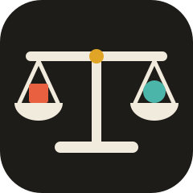
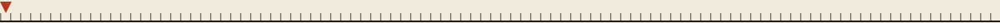
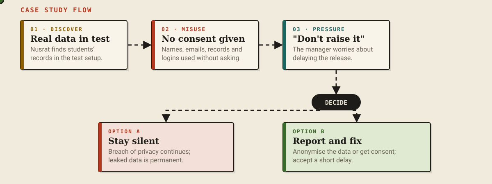
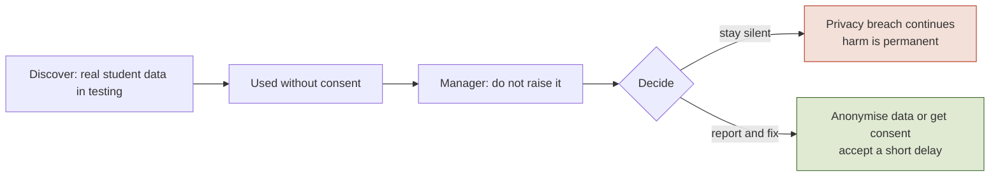

<p align="center">
  
</p>

<p align="center">
  
</p>

<p align="center">
  
  
  
  
  
</p>

<p align="center">
  <b>A study hub for software-engineering ethics: interactive slides, videos, notes and the lecturer's decks in one dashboard.</b><br>
  Bangla explanations, English answers. No framework. No build step.
</p>

<p align="center">
  
</p>



## Contents

- [The hub](#the-hub)
- [What is this?](#what-is-this)
- [See it move](#see-it-move)
- [The four lenses](#the-four-lenses)
- [Slide map](#slide-map)
- [Controls](#controls)
- [Quick start](#quick-start)
- [Deploy to GitHub Pages](#deploy-to-github-pages)
- [Customise](#customise)
- [Project structure](#project-structure)
- [A note on the content](#a-note-on-the-content)
- [License and credits](#license-and-credits)


## The hub

The front page is a dashboard over a WebGL planet scene. It opens behind a password (the library is stored encrypted) and has dark and light modes. The content comes from `tools/library.src.js`, built into `data/library.enc.js`.

| Tile | What it holds |
|---|---|
| **Slides** | Interactive decks. The 32-slide *Ethics from Zero* deck is the first; more can be added. |
| **Videos** | YouTube videos that play in a pop-up on the page. |
| **Notes** | Lesson-note PDFs, readable in the page or downloadable. |
| **Sir's Slides** | The lecturer's own PDFs. |
| **Practice, Past Questions** | Placeholders marked "soon". |

Search with <kbd>/</kbd>, filter by topic chips, tick the ✓ on a card to track progress, and step through videos with the arrows in the player. The **Effects** button turns the 3D scene off. To add a video, note or deck, follow **[GUIDE.md](GUIDE.md)**.

## What is this?

A study deck for a university course in **software engineering professional ethics**. It starts with the question "what is ethics?" and builds up to ethical frameworks, computer ethics, relevant laws, professional codes (ACM and IEEE) and a worked case study.

It is written for someone who has never studied the subject. Every idea arrives with an example from software work, and the deck keeps asking *why*, because "I just felt like it" is not an ethical argument.

| | |
|---|---|
| **Looks like** | A ruled notebook: paper, ink, one red margin line. No gradients, no glow. |
| **Feels like** | Slides with staggered reveals, flows, a playable trolley problem and flip-cards. |
| **Runs as** | A static file (the deck is `decks/ethics/index.html`). Works offline once fonts are cached, and on a phone with swipe. |

## See it move

The case-study slide, drawn as an animated diagram. The dots travel the path, then split at the decision.

<p align="center">
  
</p>

The same decision as a static diagram:



## The four lenses

Each framework asks a different question. The deck shows where they agree and where they split.

<p align="center">
  
</p>

## Slide map

<details open>
<summary><b>32 slides in five parts</b> (click to collapse)</summary>

| # | Part | What you learn |
|---|---|---|
| 1-2 | **Start** | Title and the course roadmap |
| 3-7 | **Foundations** | What ethics is; ethics vs professional ethics; law vs ethics vs preference (Venn); good person vs good engineer; why software needs ethics (scale, permanence, opacity) |
| 8-16 | **Frameworks** | Playable trolley problem; why intuition does not scale; Deontology; Utilitarianism; Virtue Ethics; Rights-Based Ethics; side-by-side comparison; the Anchor of Justification |
| 17-23 | **Computer ethics** | Definition and Moor's view; four foundations; core issues; a short history; Bangladesh and international laws; ACM and IEEE codes; flip-card scenarios |
| 24-30 | **Case study** | The scenario as a flow; sample answers on ethical issues, the two frameworks, and an ICT principle; time and writing strategy |
| 31-32 | **Check** | Seven-question quiz with explanations; closing slide |

</details>

## Controls

| Action | Keys / gesture |
|---|---|
| Next slide | <kbd>→</kbd> <kbd>↓</kbd> <kbd>Space</kbd> <kbd>PageDown</kbd>, or swipe left |
| Previous slide | <kbd>←</kbd> <kbd>↑</kbd> <kbd>PageUp</kbd>, or swipe right |
| First / last | <kbd>Home</kbd> / <kbd>End</kbd> |
| Fullscreen | <kbd>F</kbd> or the ⛶ button |
| Jump to a slide | Add `#12` to the URL |

The stage is a fixed 1280 x 720 canvas that scales to any window, so layouts stay the same on a laptop, a projector or a phone.

## Quick start

```bash
git clone https://github.com/USERNAME/REPO.git
cd REPO
open index.html            # or double-click it (YouTube needs the server below)
# or serve it locally
python3 -m http.server 8000   # then visit http://localhost:8000
```

## Deploy to GitHub Pages

1. Create a repository and push these files to the `main` branch (the root of the repo, not a subfolder). Read the copyright note in [GUIDE.md](GUIDE.md#before-you-make-the-repo-public) first, because `files/` holds third-party PDFs.
2. Open **Settings → Pages**.
3. Under **Build and deployment**, choose **Deploy from a branch**, then pick `main` and `/ (root)`, and save.
4. After a minute your site is live at `https://USERNAME.github.io/REPO/`.
5. Open `index.html` and `decks/ethics/index.html` and change the `og:image` meta tag to the absolute URL, for example `https://USERNAME.github.io/REPO/og-image.png`, so link previews show the card.

`.nojekyll` is included so GitHub serves the files exactly as they are.

## Customise

- **Hub content**: edit `tools/library.src.js` and run `node tools/build-library.mjs PASSWORD` (see the guide).
- **Deck colours** live in the `:root` block at the top of the `<style>` in `decks/ethics/index.html` (`--paper`, `--ink`, `--r` red, `--t` teal, `--g` green, `--a` ochre).
- **Deck slides** are `<section class="slide">` blocks. Add the class `r` to anything that should reveal itself; order is automatic, or set `style="--i:3"` to control it.
- **Entrance direction**: add `l`, `rt`, `z` or `d` next to `r` (from left, from right, zoom, from top).
- **Quiz questions** are the `Q` array near the end of the script.
- **Logo and icons**: `favicon.svg` is the master. The PNG and ICO files were rendered from the same geometry.

## Project structure

```text
.
├── index.html                  the hub (dashboard + planet scene)
├── GUIDE.md                    how to add videos, notes, decks
├── data/
│   └── library.enc.js          encrypted library the hub loads
├── tools/
│   ├── build-library.mjs       encrypts the library
│   └── library.src.js          editable source (git-ignored)
├── decks/
│   └── ethics/index.html       the 32-slide deck
├── files/
│   ├── notes/                  lesson-note PDFs
│   └── sirs-slides/            lecturer PDFs
├── 404.html                    friendly not-found page
├── favicon.ico                 16, 32, 48, 64 px
├── favicon.svg                 vector favicon
├── favicon-16x16.png
├── favicon-32x32.png
├── apple-touch-icon.png        180 px
├── android-chrome-192x192.png
├── android-chrome-512x512.png
├── maskable-512.png            safe-zone icon for Android
├── mstile-150x150.png
├── safari-pinned-tab.svg
├── site.webmanifest
├── browserconfig.xml
├── og-image.png                1200 x 630 social card
├── robots.txt
├── .nojekyll
├── assets/
│   ├── logo.svg                animated logo
│   ├── banner.svg              README hero
│   ├── typing.svg              rotating taglines
│   ├── frameworks.svg          four lenses, highlighted in turn
│   ├── flow.svg                case-study flow with travelling dots
│   ├── divider.svg             moving ruler
│   └── logo-256.png
├── LICENSE
└── README.md
```

All README animations are plain SVG with CSS and SMIL. GitHub shows them because they are loaded as images, and they contain no scripts.

## A note on the content

This is an **unofficial study aid** written by a student. It summarises lecture material in simpler words and is **not affiliated with, or endorsed by, any university or instructor**. Slides and notes belong to their authors.

- Check anything you plan to rely on against your official course material.
- Laws change. The Bangladesh cyber-law entries reflect the course notes at the time and may since have been amended or replaced, so confirm the current text before citing them.
- The case-study answers show *how to structure* an ethical argument. Write your own reasoning when you are assessed, and follow your institution's academic-integrity policy.

## License and credits

Code and design: [MIT](LICENSE). The study text is shared for learning; please credit the repository if you reuse it.

The hub planet scene uses [three.js](https://threejs.org) and [Lenis](https://github.com/darkroomengineering/lenis) (both MIT), loaded from CDNs. Fonts are loaded from Google Fonts under the SIL Open Font License: [Inter](https://fonts.google.com/specimen/Inter), [Fraunces](https://fonts.google.com/specimen/Fraunces), [Hind Siliguri](https://fonts.google.com/specimen/Hind+Siliguri) and [JetBrains Mono](https://www.jetbrains.com/lp/mono/).


<p align="center">
  <br>
  <sub>Press <kbd>→</kbd> and keep asking <i>why</i>.</sub>
</p>
